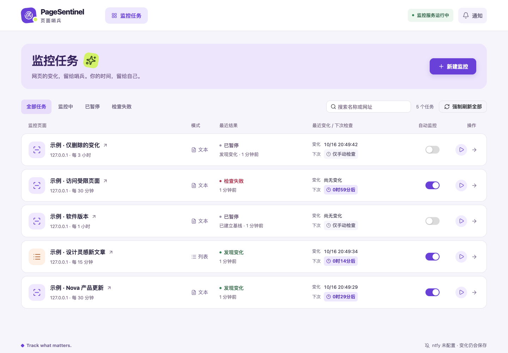
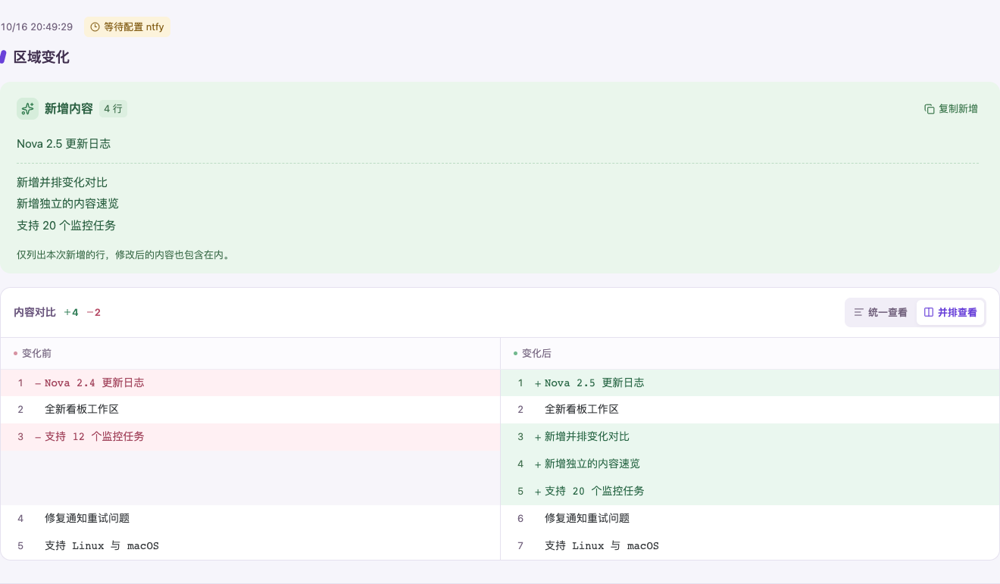

<div align="center">
  
  <h1>PageSentinel · 页面哨兵</h1>
  <p><strong>把重复刷新，交给哨兵。</strong></p>
  <p>自部署的网页变化监控工具。选中关心的内容，查看清晰的变化证据，在有新消息时收到提醒。</p>
  <p>
    
    
    
    
    
  </p>
  <p>
    <a href="#快速开始">快速开始</a> ·
    <a href="#你可以用它做什么">功能</a> ·
    <a href="#通知怎么工作">通知</a> ·
    <a href="#更新与备份">更新与备份</a> ·
    <a href="#路线图">v0.2 计划</a>
  </p>
</div>



<p align="center"><sub>当前版本真实界面，截图使用受控演示数据。</sub></p>

**当前可用：v0.1 公开网页监控。** v0.2 正在规划“专用窗口登录”和“Cookie / storageState 导入”，方案待评审，尚未实现。[查看设计](docs/v0.2-DESIGN.md) · [查看实施计划](docs/v0.2-PLAN.md)

## 你可以用它做什么

- **跟进版本发布**：更新日志中的版本号和说明修改后，查看具体增删内容。
- **盯住新文章、新公告**：列表出现历史未见链接时提醒，重排和旧条目回归不会重复通知。
- **关注指定区域**：只检查价格、状态或某段正文，排除动态时间等干扰元素。
- **少开几个标签页**：后端持续检查，变化通过 ntfy 送到订阅设备。

| 能力            | 使用体验                                                         |
| --------------- | ---------------------------------------------------------------- |
| 区域变化 · TEXT | CSS 选择区域；独立检阅、复制新增内容；统一或左右并排查看前后差异 |
| 列表新增 · LIST | 根据历史链接去重；保留每次新增的标题和详情链接                   |
| 规则预览        | 保存前真实采集，显示匹配结果和失败原因，不改变正式基线           |
| 后台调度        | 自定义时分间隔、随机错峰、任务独立启停、单项检查与强制刷新全部   |
| 变化证据        | 最近成功内容、页面缩略图、变化历史、精确到秒的执行记录           |
| 通知            | 页面提醒、浏览器系统通知，以及独立的 ntfy 后台推送               |
| 自部署          | Vue + Fastify 单容器；SQLite 保存在项目 `data` 目录              |

<details>
<summary><strong>看看变化详情</strong>：先读新增，再比较前后</summary>



截图中的任务和内容均为演示数据；图片展示当前已实现的功能。

</details>

## 快速开始

准备 Docker、Docker Compose v2；macOS 可使用 Docker Desktop。下载源码后，在项目根目录执行：

```sh
# 已有配置会被保留
[ -f .env ] || cp .env.example .env

docker compose up -d --build
```

打开 **[http://127.0.0.1:3000](http://127.0.0.1:3000)**，即可创建第一个监控。ntfy 可以稍后配置。

- 默认只允许本机访问；远程访问请使用带鉴权的反向代理，并设置 `PUBLIC_HOST`。
- 数据目录为 `./data`，映射至容器 `/app/data`。请只运行一个实例访问同一数据库。
- 首次构建需要下载 Node、Chromium 和系统依赖；后续更新会复用构建缓存。

### 创建第一个监控

1. 点击 **新建监控**，填写名称和公开 HTTP(S) 网址。
2. 选择 **区域变化** 或 **列表新增**，填写 CSS 选择器。
3. 点击 **测试规则**，确认预览包含你关心的内容。
4. 设置检查间隔并保存。首次成功采集只建立基线，后续有效变化才生成变更通知。
5. 在详情查看当前内容、变化历史和执行记录。

TEXT 的选择器必须匹配一个区域，可逐行填写要排除的子元素选择器。LIST 的选择器匹配列表项；标题和链接选择器相对于每个列表项填写，链接必须唯一且有效。

### 调度方式

小时可选 **0—24**，分钟可选 **0—60**，总间隔至少 1 分钟；每次下次检查时间随机增减 **5—10 秒**。后台限制并发，同站访问错峰，失败会退避重试。

关闭某个任务的自动监控后，仍可手动检查；**强制刷新全部**会包含暂停任务，并在每项完成后重新计算检查时间。开启、关闭操作也会写入执行记录。

## 通知怎么工作

三种提醒可以按需使用：

| 方式           | 消息如何到达                                      | 关闭 PageSentinel 页面后               |
| -------------- | ------------------------------------------------- | -------------------------------------- |
| 页面消息提醒   | 当前页面轮询后端，显示结果提示                    | 停止接收新提示                         |
| 浏览器系统通知 | 当前页面调用浏览器通知 API，需要站点和系统授权    | 当前实现停止接收新通知                 |
| ntfy           | 后端向主题发布变化，手机 App 或 ntfy 网页订阅接收 | 后端继续发送；接收端需保持相应通知能力 |

**ntfy 是通知中转站。** 它让手机接收本地服务的消息，无需将 PageSentinel 开放到公网。Web 后台推送的浏览器支持见 [ntfy 文档](https://docs.ntfy.sh/subscribe/web/)。

在 `.env` 中设置你自己的完整主题地址：

```dotenv
NTFY_URL=https://ntfy.sh/your-long-random-topic
# 主题需要鉴权时再填写；不要将真实 Token 提交到 Git
# NTFY_TOKEN=your-access-token
```

在 [ntfy 手机客户端或网页](https://docs.ntfy.sh/)订阅同一主题，然后执行 `./deploy.sh` 加载配置。

变化内容或摘要会发送到所配置的主题服务。首次基线、无变化和采集失败不发送 ntfy 变更消息。未配置或发送失败时，变化事件仍留在数据库中，后续会补发；因此首次配置后可能收到积压消息。通知采用至少一次投递，崩溃恢复的极端情况下可能重复。

右上角通知中心还能查看最近结果、标记已读、清空当前浏览器中的通知；清空不会删除任务的执行历史或变化证据。

## 更新与备份

### 一键更新

更新源码或 `.env` 后，在项目根目录执行：

```sh
./deploy.sh
```

脚本会检查配置、利用缓存构建镜像、替换容器并等待健康检查。支持通过完整路径从其他目录运行，只依赖 Docker、Compose v2 和 curl。

构建失败时保留旧服务；替换期间会短暂中断访问。启动或健康检查失败时脚本返回非零退出码，并显示排查命令。脚本保留 `.env`、`data`，不执行 Git 操作或清理镜像。

### 备份与恢复

先停止服务，再复制整个 `data` 目录，包含可能存在的 SQLite WAL 文件：

```sh
docker compose stop
# 将整个 data 目录复制到你自己的备份位置
# 备份完成后恢复服务
docker compose up -d
```

恢复时也应先停止服务，再用完整备份替换 `data`。旧版命名卷迁移说明见[开发与维护指南](docs/DEVELOPMENT.md#部署与数据维护)。

### 常用维护命令

```sh
docker compose ps                         # 查看容器状态
docker compose logs --tail 100 -f          # 查看日志
curl -fsS http://127.0.0.1:3000/api/health # 健康检查
docker compose down                       # 停止并移除容器，项目 data 仍保留
```

## 本地开发

使用 Node.js 24；项目声明的最低版本为 22.12。首次准备：

```sh
npm ci
npm run browser:install
[ -f .env ] || cp .env.example .env
DATA_DIR=./data/dev npm run dev
```

开发页面为 **http://127.0.0.1:5173**，Vite 代理 API 到 3000。运行前请停止占用 3000 的生产容器；上面的命令将开发库放在独立的 `data/dev` 子目录，避免连接生产数据库。Linux 可使用 `npx playwright install --with-deps chromium` 安装浏览器依赖。

```sh
npm test       # 真实 Chromium、SQLite、受控 HTTP 接收端及部署脚本回归
npm run build # Vue 类型检查、服务端编译、Vite 生产构建
npm start     # 提供构建后的页面与 API
```

模块、API、环境参数和回归标准集中在[开发与维护指南](docs/DEVELOPMENT.md)。

## 常见问题

**电脑休眠或关闭后还会检查吗？** 监控需要运行 PageSentinel 的设备和 Docker / Node 服务持续工作；ntfy 负责传递已产生的消息。

**为什么页面有变化，却没有收到提醒？** TEXT 只比较选中区域；LIST 只识别历史未见链接，同链接改标题不会通知。先查看执行记录，确认规则匹配成功，再检查通知配置与权限。

**缩略图会进行像素差异检测吗？** 当前缩略图用于快速预览，变化判定使用提取的文本或列表链接。

**现在能监控需要登录的网站吗？** 尚不能。两种登录态获取方式已进入 v0.2 设计，评审和验收通过后才会发布。

**为什么部署遇到 502？** 如果错误来自基础镜像仓库或镜像代理，请恢复该连接后重试。缓存构建也可能查询基础镜像元数据；`deploy.sh` 会在构建失败时停止，保留原服务。

**能监控内网地址吗？** 当前采集仅允许公开网络地址。默认容器还会阻断内网、回环、保留网段和 IPv6 出站连接；内网 ntfy 也不可达。

## 路线图

| 版本 | 状态   | 范围                                                                   |
| ---- | ------ | ---------------------------------------------------------------------- |
| v0.1 | 已实现 | 公开页面 TEXT / LIST、后台调度、变化证据、通知与单容器部署             |
| v0.2 | 待评审 | 登录身份、专用窗口登录、Cookie / storageState 导入、失效恢复与凭证保护 |

v0.2 继续沿用现有提取、差异、调度和持久化能力。计划中的可视化元素选择、像素差异、自动分页、多用户协作均不属于本次版本范围。

## 文档与反馈

- [开发与维护指南](docs/DEVELOPMENT.md)：当前架构、接口、限制、配置和验收依据。
- [v0.2 设计方案](docs/v0.2-DESIGN.md)：用户流程、专用窗口如何连接 Docker、凭证与会话边界。
- [v0.2 实施计划](docs/v0.2-PLAN.md)：开发顺序、文件范围、回归与发布门槛。
- [产品边界](PRODUCT.md) · [视觉规范](DESIGN.md)：供后续开发保持一致。

反馈问题时请说明部署方式、复现步骤和脱敏的规则；涉及登录时，请使用可公开的复现站点或测试账号，不附带真实 Cookie、Token、storageState 或私人页面截图。

当前仓库未提供 `LICENSE` 文件，许可证待维护者确定。
