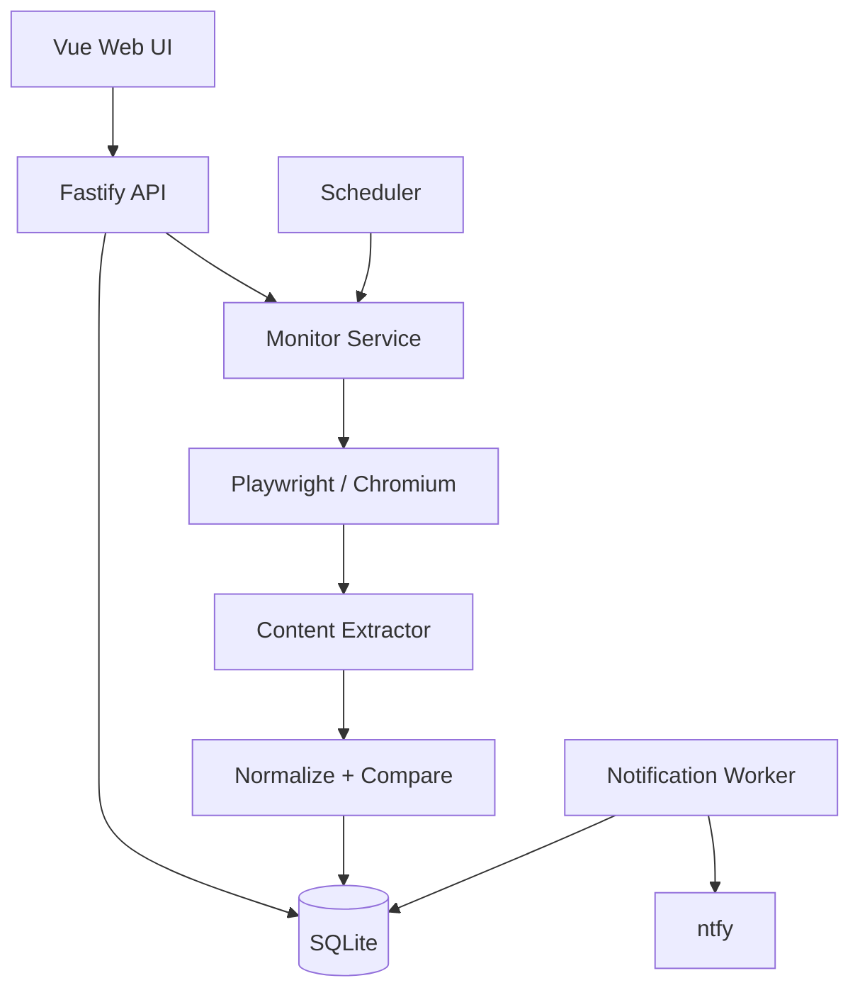

# 技术架构与监控引擎

## 1. 技术选型

| 层次 | 技术 | 用途 |
| --- | --- | --- |
| 前端 | Vue 3、TypeScript、Vite | 规则配置、结果查询、差异展示 |
| 组件 | Naive UI 或已有组件库 | 表单、抽屉、列表、确认弹窗 |
| API | Node.js、Fastify、TypeScript | 配置校验、任务管理、查询接口 |
| 浏览器 | Playwright、Chromium | 公开网页渲染、DOM 提取 |
| 存储 | SQLite、better-sqlite3 | 规则、快照、已见条目、执行与通知状态 |
| 文本比较 | diff | 行级或词级差异 |
| 调度 | 进程内循环 | 扫描到期任务和限制并发 |
| 通知 | ntfy HTTP 接口 | 推送有效变化 |
| 部署 | Docker | 单实例、单容器运行 |

Node.js 直接调用 Playwright，前后端共享 TypeScript。首版不引入 Java 服务、Redis、分布式队列或独立 Worker 集群。具体依赖版本在实施时确认。

## 2. 架构与职责



| 建议模块 | 职责 |
| --- | --- |
| `client/src/views/MonitorList.vue` | 任务列表 |
| `client/src/views/MonitorDetail.vue` | 变化和执行历史 |
| `client/src/components/MonitorEditor.vue` | 创建、编辑、规则测试 |
| `client/src/components/ChangeDiff.vue` | TEXT 差异展示 |
| `server/src/monitor/browser.ts` | Chromium 生命周期、Context、导航、超时 |
| `server/src/monitor/extractor.ts` | TEXT / LIST 提取和结果校验 |
| `server/src/monitor/comparator.ts` | 纯数据标准化、比较 |
| `server/src/monitor/scheduler.ts` | 到期扫描、并发与退避 |
| `server/src/monitor/monitor-service.ts` | 编排采集、比较、持久化 |
| `server/src/notification/ntfy.ts` | 推送与通知状态处理 |
| `server/src/db/`、`server/src/routes/` | 数据库初始化和 API 路由 |

按真实职责拆分，两个模式使用枚举和简单分支，不预建 Strategy、Factory、Repository 等抽象层。

## 3. 一次正式检查的流程

1. 获取任务执行资格，防止同一任务重复运行。
2. 复用 Chromium 进程，为本次检查创建独立非持久化 BrowserContext。
3. 访问页面，检查导航结果，等待目标元素出现。
4. 反复提取目标数据，确认内容达到稳定条件。
5. 校验结果、执行标准化；异常则记录失败，保留已有基线。
6. 首次有效采集建立基线，不通知；后续有效采集执行比较。
7. 用数据库事务保存基线、已见条目、变化事件和相关状态。
8. 关闭 Context；通知处理器在事务外发送待推送事件。

### 页面稳定性初始策略

- 导航超时建议 20 秒，目标元素等待建议最多 10 秒。
- 约每秒读取一次提取结果，连续两次一致视为稳定，同时设置总等待上限。
- 不稳定、超时、HTTP 403 / 429、提取失败均不参与比较。
- 不将 `DOMContentLoaded` 或 `networkidle` 单独当作业务内容已经就绪的证明。

连续相同采样只能作为首版启发式判断，不能保证所有动态页面已经完全加载。开发时使用受控 SPA 验证等待策略。

## 4. TEXT 模式

1. CSS 选择器必须恰好匹配一个目标区域。
2. 排除指定子元素，提取可见文本；不要改变目标页面的业务状态。
3. 规范化连续空白和换行，保留文本内容语义。
4. 计算 SHA-256，与上次成功基线比较。
5. 哈希相同时记录检查成功；不同时保存新快照和文本差异。

不要默认删除数字、日期或任意正则匹配内容，它们可能正是监控目标。

```diff
- 当前版本：v2.3.0
+ 当前版本：v2.4.0
  支持 Windows、macOS 和 Linux
+ 新增 ARM64 原生支持
```

## 5. LIST 模式

每条记录提取 `key`、`title`、`url`。详情链接必须稳定、可解析为 HTTP(S) URL。

```text
key = SHA256(normalizedAbsoluteURL)
newItems = currentItems - allSeenItems
```

URL 规范化只做确定性处理：解析相对路径、移除片段 `#fragment`。保留查询参数，避免把不同条目合并。

任务长期维护历史已见集合，不只与上次列表比较。例如：

| 次数 | 当前采集 | 结果 |
| --- | --- | --- |
| 首次 | A、B、C | 全部记入已见集合，不通知 |
| 第二次 | D、A、B | 只通知 D |
| 第三次 | B、D、A | 重排，不通知 |
| 第四次 | C、B、D | C 历史已见，不通知 |

首版只检查指定页面。页面两次采集之间出现又消失的条目，或只出现在其他分页的条目，无法保证发现。

### 提取校验

- 每个列表项必须有稳定详情链接。
- 同次采集 Key 必须唯一；缺失链接、重复 Key 时提示修正规则。
- 不静默改用标题哈希，避免标题修改被识别为新增。
- 空列表默认视为异常，不更新历史状态。
- 超出结果上限时报错，不静默截断。

## 6. 状态和误报规则

| 情况 | 处理 |
| --- | --- |
| 首次有效采集 | 建立基线，不生成变化通知 |
| 只有空白变化 | 标准化后忽略 |
| 列表重排、旧条目再次出现 | 使用历史 Key 去重 |
| 选择器失效、网络超时、空列表 | 记录失败，保留基线和已见集合 |
| 403 / 429 | 记录失败并退避 |
| 修改 URL、模式、提取规则 | 重建基线，首次有效结果不通知 |
| 只修改名称、检查间隔 | 沿用现有基线 |
| 服务重启 | 恢复规则、基线、已见集合、待发通知 |

## 7. 调度和通知

- 每 30 秒扫描 SQLite 中到期且启用的任务，全局并发建议为 2。
- 同一任务只能有一次正式检查在运行，自动与手动执行共用限制。
- 同站任务适当错峰；失败按连续失败次数退避，并设置最大间隔。
- 执行后保存 `next_run_at`；重启后处理到期任务，无须补跑停机期间每一个周期。
- ntfy 目标通过环境配置，变化事件持久化后独立发送。
- 通知失败保留待处理状态，服务重启后继续；采用至少一次投递语义，极端情况下允许重复推送。

## 8. 部署和技术风险

| 风险 | 首版措施 |
| --- | --- |
| SPA 异步加载、动态时间 | 稳定采样、精确选择区域、排除动态子元素 |
| 页面结构变化或访问限制 | 明确记录失败，提示修正规则；不做绕过 |
| 浏览器资源占用 | 复用进程、限制并发、及时关闭 Context |
| 崩溃或重启 | SQLite 状态持久化、事务、待发通知恢复 |
| 任意 URL 引发 SSRF | 仅 HTTP(S)、默认本机监听或代理鉴权、浏览器网络出口隔离 |

监控浏览器会访问重定向和页面子资源，不能只靠输入 URL 校验防护 SSRF。部署时限制其访问内部敏感网段，以非 root 用户运行并配置浏览器沙箱和必要隔离。首版仅支持公开网页，不以无鉴权形式暴露到公网。

公共 ntfy 主题使用不可猜测的名称，避免发送敏感内容；私密场景可使用自部署 ntfy。
